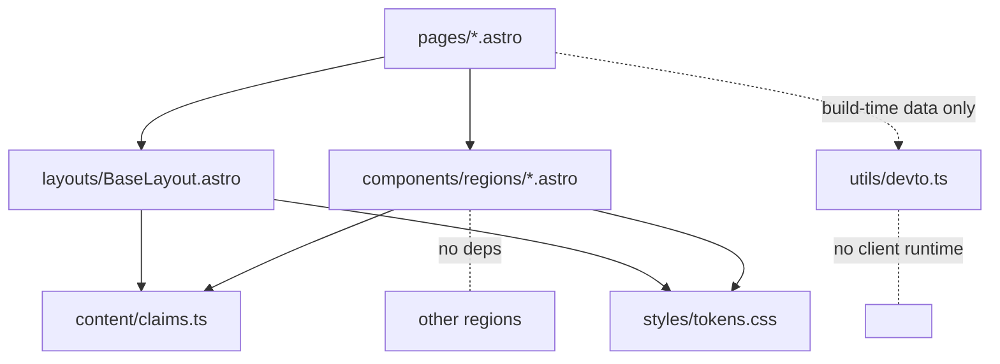

# Architecture Spine — echowaves.com Blueprint redesign

## Design Paradigm

**Document-first static rendering.** The site is a set of server-rendered HTML documents at build time. React islands are the exception mechanism, and this design has none: every region of the sheet (annotations, grid, decodable artifact, feed snapshot) is markup + CSS native. Astro `.astro` components compose pages; scoped `<style>` blocks carry region CSS; global scope holds only tokens and reset.



Regions never import each other or `utils/`; pages wire build-time data into region props. Nothing in `components/` runs in the browser.

## Invariants & Rules

### AD-1 — Zero client runtime, site-wide [ADOPTED]

- **Binds:** all pages and components
- **Prevents:** two rendering idioms for one sheet; hydration payload and mount-time data drift (the shipped `Blog.tsx` refetch bug) recurring
- **Rule:** No React, no islands, no inline scripts on any page. `Support.tsx`/`Privacy.tsx` are hook-free static JSX and convert to `.astro`; at ship time `@astrojs/react`, `react`, and `react-dom` leave `package.json`. If a future behavior genuinely needs JS, it ships as a minimal script owned by its region and gets a new AD first.

### AD-2 — Token pipeline: DESIGN.md → tokens.css, exact names

- **Binds:** all styles
- **Prevents:** palette drift between the visual contract and CSS; scattered hex literals
- **Rule:** `src/styles/tokens.css` transcribes every DESIGN.md frontmatter token 1:1 as a CSS custom property (`colors.cyan` → `--cyan`, `spacing.section-gap` → `--section-gap`, `typography.annotation` → the `--type-annotation-*` longhand group). Hex literals and font stacks appear nowhere else. Components use `var(--token)` only; adding a visual value means adding a token to DESIGN.md first.

### AD-3 — Claims module is the single copy owner

- **Binds:** all user-visible strings, head metadata
- **Prevents:** thesis/CTA/title paraphrase drift between `<head>`, og tags, and rendered copy (EXPERIENCE.md "claims of record" and committed strings)
- **Rule:** `src/content/claims.ts` exports the typed claims-of-record inventory (roles, figures, contexts per EXPERIENCE.md IA region 2) and the committed literals (`thesis`, `pageTitle`, `pageDescription`, `ctaLinkedIn`). Components and `BaseLayout` import from it; no copy literals inside components. Updating a figure means editing the module first.

### AD-4 — One component per IA region, composed in IA order

- **Binds:** home page structure
- **Prevents:** region reordering (esp. demoting the AI practice) and section sprawl off the contract
- **Rule:** `src/components/regions/` holds exactly one `.astro` per EXPERIENCE.md IA region — `TitleBlock`, `CareerSchematic`, `AiPractice`, `OperatorProfile`, `OpenSource`, `Writing`, `Contact` — plus `SheetChrome` (nav+footer). `index.astro` composes them in IA order and owns no markup beyond landmarks; reordering regions requires editing the EXPERIENCE.md spine first.

### AD-5 — Build-time-only data flow with honest snapshots

- **Binds:** writing feed, any future external data
- **Prevents:** false freshness and fabricated counts (`0+`); client/server truth divergence
- **Rule:** `utils/devto.ts` fetches server-side at build; `getBlogData()` returns `{ posts, fetchedAt? }` where `fetchedAt` exists only from real API/build metadata. The `Writing` region renders props statically and implements the EXPERIENCE.md State Patterns (available / pending / stale-snapshot / empty) with no client fetch and no synthetic numbers.

### AD-6 — Head/metadata owned by BaseLayout, fed by claims

- **Binds:** `<head>` of every page
- **Prevents:** recurrence of package-catalogue identity and the banned `#0d1117` theme-color
- **Rule:** `BaseLayout.astro` is the only `<head>` author. It receives committed strings from `claims.ts`; `theme-color` = `#0F1620` (canvas token). JSON-LD `Person` describes the executive-portfolio identity (`sameAs`: GitHub, LinkedIn, dev.to); the three `SoftwareSourceCode` entries remain as factual package evidence — catalogue framing is gone from title/description.

### AD-7 — Accessibility mechanisms are fixed, not improvised

- **Binds:** CareerSchematic, grid background, focus styles, motion
- **Prevents:** per-component reinvention of a11y behavior that the UX spine already committed
- **Rule:** The career schematic renders as a semantic ordered list (SVG/CSS drawing is decorative overlay, `aria-hidden`). Grid backgrounds are CSS-only and `aria-hidden`. Focus-visible rings use the DESIGN.md `components.keyboard-focus` token values and satisfy 3:1 against both adjacent backgrounds. All decorative motion sits behind `prefers-reduced-motion` with the static state as default. Interactive targets ≥24×24 CSS px except inline links.

### AD-8 — Zero webfonts

- **Binds:** typography loading
- **Prevents:** re-adding font CDNs to "recover" the retired JetBrains Mono terminal look
- **Rule:** Only the system sans and `ui-monospace` stacks from DESIGN.md ship. No font files, no external font requests.

### AD-9 — Envelope unchanged [ADOPTED]

- **Binds:** build, routes, integrations
- **Prevents:** release breakage of a live site whose deploy pipeline lives outside the repo
- **Rule:** Astro `output: 'static'`, `site: https://echowaves.com`, sitemap integration, gtag analytics, and the `/` · `/support` · `/privacy` route set stay as-is. Output shape (`dist/`) must not change; deploy method is verified before release (open question below).

## Consistency Conventions

| Concern | Convention |
| --- | --- |
| Naming | Region components PascalCase `.astro`, one per IA region; tokens kebab-case identical to DESIGN.md keys; claims exports camelCase. |
| Data & formats | Dates ISO strings at the data layer; display formatting only in region templates. dev.to payload normalized in `devto.ts` (single normalizer, as today). |
| Region anchors & nav | Each region renders `id` = its kebab-case region name (`title-block`, `career-schematic`, `ai-practice`, `operator`, `open-source`, `writing`, `contact`); SheetChrome's nav links target exactly these ids. Nav labels come from `claims.ts`. |
| State & cross-cutting | No client state. Build failures degrade per AD-5 states, never abort the page build for feed errors (warn + empty-state). Config literals (site URL, API endpoints) live beside their owner module; no env vars needed. |

## Stack

SEED — verified against installed reality 2026-10-17; code owns this once it exists.

| Name | Version |
| --- | --- |
| Node | 24.x (installed 24.14.0) |
| Astro | 6.1.10 installed (`output: 'static'`) |
| @astrojs/sitemap | kept |
| TypeScript | as configured today |
| @astrojs/react + react + react-dom | removed at ship per AD-1 |

## Structural Seed

```text
src/
  styles/        # tokens.css (from DESIGN.md), reset/global, sheet chrome layout css
  content/       # claims.ts — claims of record + committed strings
  utils/         # devto.ts (build-time fetch, unchanged transport)
  components/
    regions/     # TitleBlock, CareerSchematic, AiPractice, OperatorProfile, OpenSource, Writing, Contact, SheetChrome (.astro + scoped style)
  layouts/       # BaseLayout.astro — sole <head> author
  pages/         # index.astro (composition only), support.astro, privacy.astro (converted to .astro content)
```

Old `src/components/*.tsx` and their `.css` files are deleted in the same change that lands their replacements — no transitional coexistence.

## Deferred

- **Deploy pipeline verification** — not repo-owned; confirm host/publish flow before release (blocks release, not build).
- **OG image / manifest refresh** — `og:image` and PWA icons still depict the old identity; content decision independent of structure.
- **Motion choreography details** — schematic reveal sequencing is a build-time craft call behind `prefers-reduced-motion`; no library pinned on purpose.
- **Analytics events** — gtag stays as-is; redesign-specific event taxonomy deferred until post-launch measurement.
